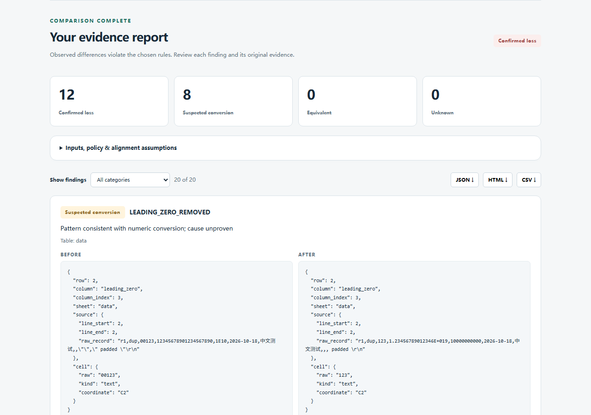

# ImportProof

[](https://github.com/KaiserIIII/importproof/actions/workflows/tests.yml)

Compare the table you started with against the file you received. Keep the original values, the comparison rules and the evidence for every finding.

ImportProof is a local CSV, TSV and XLSX import-fidelity review tool for Windows and Linux. It detects observed changes and flags patterns consistent with accidental conversions. It cannot identify which application changed a file, prove intent, recover overwritten data, or certify a whole business migration.

[中文使用说明](docs/USER_GUIDE_ZH.md) · [Comparison contract](docs/COMPARISON_CONTRACT.md) · [Competitors and executed baselines](docs/COMPETITORS.md) · [Acceptance](docs/ACCEPTANCE.md) · [Security](docs/SECURITY.md)



Source candidate 0.1.0: **79 tests passed in each fresh Windows and isolated Linux environment**. Real LibreOffice 26.2.5.2 imports/exports and browser checks against both platform servers were executed. [Executed scope and NOT RUN items](PUBLICATION_READINESS.md).

**Experimental scope: ordinary real Calc XLSX files, including an unchanged text control, can return UNKNOWN due unsupported metadata. Normal CSV controls passed.** [Real conversion results](REAL_CONVERSION_RESULTS.md) · [Readiness and remaining limits](PUBLICATION_READINESS.md).

## What happened in real Calc

LibreOffice Calc **26.2.5.2** actually imported the controlled source CSV using default, explicit-text and special-number options, then saved CSV and XLSX. The five-case campaign produced ten original exports through the real headless UNO application, with cell types, import options and hashes retained. It was not an interactive GUI test or a production migration.

| Original field | Default Calc CSV export | Explicit text-column export |
| --- | --- | --- |
| Leading zeros: `00123` | `123` | `00123` |
| 20-digit ID: `12345678901234567890` | `1.23456789012346E+019` | Original 20 digits |
| Scientific-looking text: `1E10` | `10000000000` | `1E10` |
| Quoted empty string | Unquoted empty | Unquoted empty |

ImportProof retained evidence for all 28 observed lexical CSV changes across the three risk pairs. Both normal text CSV controls were EQUIVALENT. The text-protected risk CSV still had three strict empty-representation findings; only an explicitly selected `null_tokens: [""]` policy made that pair equivalent. All five actual XLSX exports remained UNKNOWN; observed numeric/type changes were retained alongside uncertainty. These small controlled cases are not a broad accuracy estimate. [Exact options, original exports, reports and csv-diff/daff comparisons](REAL_CONVERSION_RESULTS.md).

## Install and run

Use **Python 3.13** and a fresh environment in this source directory. Python 3.12 is unsupported: its `csv.QUOTE_NOTNULL` reader does not preserve the quoted-empty distinction needed here. Dependencies are pinned by version and wheel hash; source revisions and licenses are recorded in [the dependency inventory](docs/DEPENDENCIES.json). Initial installation requires internet access unless the locked wheels are already available; runtime performs no external requests.

```sh
git clone https://github.com/KaiserIIII/importproof.git
cd importproof
```

Windows PowerShell:

```powershell
py -3.13 -m venv .venv
.\.venv\Scripts\python.exe -m pip install --only-binary=:all: --require-hashes -r requirements.lock
.\.venv\Scripts\python.exe -m pip install --no-build-isolation --no-deps .
.\.venv\Scripts\python.exe -m importproof serve
```

Linux:

```sh
python3.13 -m venv .venv
.venv/bin/python -m pip install --only-binary=:all: --require-hashes -r requirements.lock
.venv/bin/python -m pip install --no-build-isolation --no-deps .
.venv/bin/python -m importproof serve
```

Open **http://127.0.0.1:8766**. Keep the terminal open; Ctrl+C stops the server. Drop or choose the before and after files, set keys and ordering, and use **Advanced policy** for column semantics, encoding, separators, sheet selection and mapping. Findings include before/after values, row/column coordinates and input hashes. Filter by verdict and download HTML, JSON or CSV. The interface is English; the Chinese guide explains the same controls and contracts.

This installs a normal package, not an editable checkout: reinstall it after source edits. Uninstall with `python -m pip uninstall importproof`; remove the dedicated virtual environment when no longer needed. Input files are never modified. Reports contain original data: save them privately and review before sharing.

## CLI

Audit the checked-in original Calc export after installation:

```powershell
.\.venv\Scripts\python.exe -m importproof compare examples/real-calc/risk-source.csv examples/real-calc/risk-default/export.csv --keys row_id --output output-calc
```

This deliberately returns **2** because it finds changes and writes `report.json`, `report.html` and `report.csv`. For the normal real-Calc control, compare `examples/real-calc/control-source.csv` with `examples/real-calc/control-default/export.csv` using `--keys row_id`; that returns **0**. In the Web UI, upload the same pair and enter `row_id` as the key. Recreate the application exports with the optional [real Calc runner](REAL_CONVERSION_RESULTS.md#recorded-options-and-reproduction), which requires a separate LibreOffice installation.

Use `.venv/bin/python` on Linux. The output directory must be new and its parent must exist. Standard output is one JSON report; standard error contains errors or the output location. Exit **0** means equivalent under the recorded rules, **2** means findings or unresolved uncertainty, **1** means invalid input/processing/output failure. Argument syntax errors use argparse exit2. Check JSON as well as the exit status.

```sh
# Exact/composite identity; input row order may change:
python -m importproof compare before.csv after.xlsx --keys id,region --ignore-order
# Explicit parsing and semantic rules:
python -m importproof compare before.csv after.tsv --policy policy.json --output new-report
```

Example policy (column references are exact names or `#1`-based positions):

```json
{
  "keys": ["id"],
  "ignore_order": true,
  "text_columns": ["identifier"],
  "numeric_columns": ["amount"],
  "date_columns": ["when"],
  "date_formats": ["%Y-%m-%d", "%d/%m/%Y"],
  "trim_whitespace": false,
  "unicode_normalization": "none",
  "null_tokens": [],
  "ignore_columns": [],
  "column_map": {},
  "before": {"encoding": "utf-8", "delimiter": ","},
  "after": {"delimiter": "\t"}
}
```

Text-file options do not apply to XLSX; omit that side's parsing object for XLSX. Text, numeric and date modes cannot overlap. Keys are exact raw value/type identities, independent of semantic equivalence rules. A changed identifier is lost/added identity, not an automatically established edit. Duplicate or missing keys remain UNKNOWN; no fuzzy matching asserts equivalence. Without keys the default is positional alignment; with `ignore_order` only exact/declared-semantic multisets can match.

## Findings

| Verdict | Meaning |
| --- | --- |
| `CONFIRMED_LOSS` | An observed absence or disallowed representation/type/value change under the recorded alignment and policy. It can be intentional; the name does not establish business error or software causality. |
| `SUSPECTED_CONVERSION` | The change resembles leading-zero removal, scientific notation or date conversion. Cause and intent remain unproven. It can accompany a confirmed observed difference. |
| `EQUIVALENT` | The supported values are equivalent under the explicitly recorded rules. It is not byte equality or complete workbook/visual fidelity. |
| `UNKNOWN` | Identity, semantics, unsupported constructs or bounded processing prevent a reliable conclusion. Never treat this as a pass. |

The overall verdict prioritizes UNKNOWN, then confirmed differences, then suspected conversion, then equivalence. Counts are findings, not unique damaged cells; one change can produce a confirmed observation and a suspected mechanism. Rules that ignore whitespace, normalize Unicode or compare numbers/dates are recorded and do not change the files.

Coverage includes leading zeros, exact long-number differences, decimal value/scale, scientific spelling, Unicode/whitespace, blank/empty/missing distinctions, row/column loss/addition/order, duplicate records/keys/headers, explicit column renames, date values/formats and unevaluated formula/error cells. Original XLSX numeric XML tokens are retained without a binary-float round trip. Numbers compare with `Decimal`, dates only under declared formats or stored date typing. Full spreadsheet display rendering is outside scope.

## File support and limits

- CSV/TSV: UTF-8/BOM and UTF-16 BOM auto decoding; explicit UTF-8, UTF-8-SIG, UTF-16, CP1252 or GB18030. Strict decoding, no replacement characters. Comma/tab defaults; ambiguous semicolon/pipe/delimiter cases require explicit selection. Custom quote character, multiline fields, CR/LF/CRLF and Chinese/Unicode are supported.
- Unquoted empty and quoted `""` are distinct blank/empty representations, not automatically SQL NULL. `null_tokens` is a caller assumption. Blank physical records and ragged rows remain visible; duplicate headers are retained and require review. Header is the first record/worksheet row.
- XLSX: all worksheets by default; selected pairs via `before_sheet` and `after_sheet`. Formula text/cache and stored numeric tokens are evidence; formulas, macros and external links are never executed/fetched. XLSM/XLS/binary or encrypted workbooks are rejected. Merged/hidden/unknown constructs produce uncertainty; rich formatting is not rendered.
- Limits: **5 MiB/file, 50 MiB expanded XLSX, 1,000 ZIP members, 20 sheets, 50,000 records including header, 256 columns, 300,000 rectangular cells/document, 65,536 characters/cell, 2,000 findings, 30-second worker deadline, 16 MiB worker result**. Truncation yields UNKNOWN; processing/limit failure yields an error, never equivalence. This is bounded in-memory processing, not unlimited streaming.
- Linux workers use a 512 MiB address-space limit. **Windows has no hard worker RAM quota.** The localhost server is single-request with bounded backlog and request/response caps, not a public multi-user service or OS sandbox. Do not expose it publicly.

See [the exact contract](docs/COMPARISON_CONTRACT.md) and [known limitations](docs/KNOWN_LIMITATIONS.md).

## Reproduce

```sh
python -m unittest discover -s tests -v
python tools/verify.py output-acceptance
python tools/resource_checks.py output-resources
```

Examples use explicitly controlled, nonprivate data. `sqlite-before.csv` and `sqlite-after.csv` came from a real documented SQLite typed import/export. The legacy `before.csv`/`after-controlled.tsv` and two small XLSX fixtures contain deliberately authored changes. The separate `examples/real-calc/` folder contains original files actually exported by Calc. [Provenance](examples/PROVENANCE.md) and actual reports distinguish these sources. **Real headless LibreOffice Calc conversion now ran** on controlled inputs; [exact results/options and actual exports](REAL_CONVERSION_RESULTS.md). Excel, interactive Office GUI and production imports remain NOT RUN. Actual Chromium checks against both installed platform servers are separate from tests and hosted CI; [current acceptance](PUBLICATION_READINESS.md) states what ran, and [historical acceptance](docs/ACCEPTANCE.md) preserves the earlier evidence.

GitHub Actions runs the full source test suite and installed CLI checks on Windows and Linux, including replay of frozen real-export fixtures. It does not run Office or replace real GUI/application acceptance. **Excel GUI and production migrations are unverified; Windows has no hard worker memory quota.** This tool does not certify complete workbook equivalence.

CSV/table diffs and semantic comparison are established capabilities. Executed csv-diff/daff baselines detect most ordinary changes. ImportProof combines explicit policies, original-cell evidence and conservative verdicts into one local workflow; no algorithmic novelty or broad superiority is claimed. [Detailed overlap and results](docs/COMPETITORS.md).

MIT project source; dependencies retain their own licenses. [Third-party notices](THIRD_PARTY_NOTICES.md). No remote account connection, telemetry, CDN, paid API, PyPI publication or installer is required/provided.
