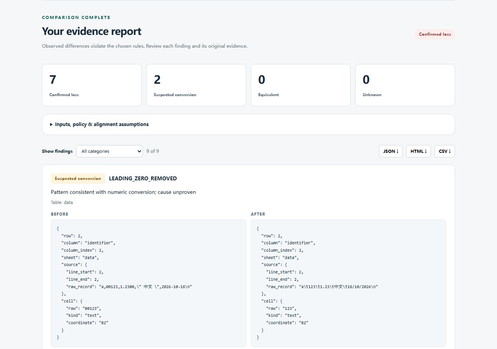

# Executed acceptance — 18 October 2026

Status: **PASS for bounded local source use**, with the NOT RUN items below. Tested implementation: `f1b04b2ce5df1c77c51acb561fe7e0536c7b2188`. Later delivery commits add documentation, screenshots and recorded reports only; the release audit verifies that executable files and tests are unchanged.

| Check | Windows | Linux |
| --- | --- | --- |
| Fresh source and environment | New local Git clone and venv | Git archive, new source directory and venv in isolated WSL distro |
| Actual environment | Windows 11 build 26200, Python 3.13.0 | Alpine Linux 3.24.2, Python 3.13.16, dedicated WSL distribution |
| Hash-locked offline install, normal package install, `pip check` | PASS | PASS |
| Import from outside source working directory | PASS, installed site-packages | PASS, installed site-packages |
| Full unittest suite | **77 passed** | **77 passed** |
| Real CLI equivalent / findings / invalid input | **0 / 2 / 1** | **0 / 2 / 1** |
| Chinese/Unicode, input hashes and original coordinates | PASS | PASS |
| Resource/adverse probes | **10 cases passed**, 16 executions | **10 cases passed**, 16 executions |

The 77 methods include one compatibility method exercising 12 fixed cases; these are not 12 additional unittest methods. The suite also uses real local HTTP requests and worker subprocesses; it is not just mocked adapters. [Windows log](evidence/windows-tests.log), [Linux log](evidence/linux-tests.log), [Windows details](evidence/windows-acceptance.json), [Linux details](evidence/linux-acceptance.json).

All four full CLI JSON reports were equal across platforms, including evidence, policy and input hashes. Ten resource-case verdicts/inputs also agreed; timing and platform metadata are intentionally different. [Comparison record](evidence/cross-platform.json).

## Commands that ran

Fresh Windows clone at the tested commit, using its own `.venv`, and fresh Linux source archive:

```sh
python -m venv .venv
# Use the new venv Python for every following command:
python -m pip install --no-index --find-links <audited-wheel-directory> --only-binary=:all: --require-hashes -r requirements.lock
python -m pip install --no-build-isolation --no-deps .
python -m pip check
python -m pip freeze --all
python -c "import importproof; print(importproof.__file__)"  # working directory outside source
python tools/verify.py <new-acceptance-directory>
python tools/resource_checks.py <new-resource-directory>
```

Every command above returned 0. `tools/verify.py` records the intentional CLI exits 2 and 1 as successful expectations, alongside exit 0. Its full command records and raw stdout/stderr are retained outside the public source in `importproof-evidence-20261018/fresh-acceptance-final/`. Wheels were previously downloaded from the recorded PyPI artifacts; a normal user can use the README online install. Linux used an existing interpreter read-only and created new ImportProof source/venv directories; it did not change another project's runtime.

## Real browser acceptance

Actual Chromium **149.0.7827.55**, on Windows against the **installed final fresh-clone package**, using real local files and HTTP endpoints with no mocked server responses: five checks passed.

1. CSV/TSV upload, exact `id` key, observed loss and original before/after evidence.
2. Risk filtering.
3. Three actual browser downloads: JSON, HTML and CSV, then parsed/checked the JSON original value.
4. Browser `File`/`DataTransfer` drop of real two-sheet XLSX bytes and equivalent self-comparison. This is a browser event, not an OS-level drag gesture.
5. 390-pixel layout without horizontal document overflow.

No page errors or external asset/API requests were observed. [Machine record](evidence/browser.json). Screenshot from that run:



Raw screenshots, server logs, browser script and trace are preserved in the external `browser-final/` evidence directory. This browser automation uses a pre-existing bundled Playwright/browser installation; neither is a runtime product dependency. Linux browser, OS drag gestures and browser accessibility audit are NOT RUN.

## Real conversion versus controlled fixtures

SQLite **3.45.3** actually imported generated text into a `REAL` column and exported it. `00123` became `123.0`; `12345678901234567` became `1.2345678901234568e+16`. ImportProof reported observed changes and suspected patterns, without inferring a source application. [Executed setup](evidence/sqlite-actual-import.json), [actual report](../examples/reports/sqlite-actual/report.html).

The CSV/TSV edits and numeric XLSX-token edits are deliberately authored test inputs. Their reports are actual tool output, not evidence that a named spreadsheet application made those changes. [Example provenance](../examples/PROVENANCE.md). The 12 compatibility pairs are also controlled cases, shared with actual csv-diff/daff runs. [Competitor results](COMPETITORS.md).

## Bounded performance and adverse inputs

Expectations were written by `tools/resource_checks.py` before the first execution of each campaign. Each equal-row size repeats three times; seven other cases run once. No thresholds were changed to improve results.

| Controlled unique rows | Windows median | Linux median | Verdict |
| --- | --- | --- | --- |
| 100-unique-rows | 0.431 s | 0.117 s | EQUIVALENT |
| 2000-unique-rows | 0.429 s | 0.149 s | EQUIVALENT |
| 10000-unique-rows | 0.535 s | 0.285 s | EQUIVALENT |

Oversized file, rectangular cell limit, overlong cell, invalid encoding and NUL-byte cases reject with errors. Formula-like text and truncated findings return UNKNOWN. All ten expected classifications passed on both platforms. [Windows observations](evidence/windows-resources.json), [Linux observations](evidence/linux-resources.json). These observations are not throughput guarantees, worst-case resource bounds or real-world false-positive estimates. Windows has no hard RAM quota; result caps apply after serialization/rendering.

## Preserved failures and NOT RUN

- Initial browser attempt could not find the bundle's expected browser revision. It was NOT RUN, then rerun with an existing explicit Chromium path. No synthetic browser success was substituted.
- First installed Windows suite exposed unread rejected-upload connection resets; a bounded body-discard fix and HTTP regressions resolved it. Original FAIL logs remain outside source.
- A resource-run directory originally used Windows reserved basename `nul`; only that case directory label changed to `null-byte`. Input bytes and predeclared rejection criterion stayed the same.
- Independent review reproduced a valid numeric header-format false equivalence and malformed duplicate-inline-string acceptance. Both were fixed, tested RED/GREEN and independently rechecked. [Review](CODE_REVIEW.md).
- Excel and LibreOffice executable/workflows: **NOT RUN**, unavailable at local inspection. No private/production importer data was used. Real office GUI, broad workbook rendering, production migrations, macOS and Python versions other than those above: **NOT RUN**.
- GitHub Actions is configured for Windows/Linux but **hosted execution NOT RUN**: no remote was created or pushed. Source CI is not application-conversion acceptance.
