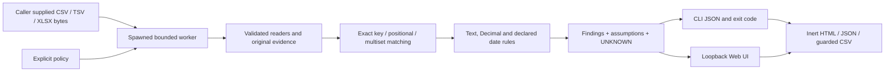

# Architecture

`readers.py` reuses Python csv, openpyxl style/epoch handling and defusedxml. OOXML raw number tokens are inspected to preserve digits that a float could discard. It does not implement a spreadsheet calculation engine. Unsupported structures become issues, not hidden normalization. `compare.py` retains alignment and rule assumptions; no fuzzy matcher. `worker.py` owns one spawned comparison process, deadlines and result bounds; POSIX address-space cap where available. `cli.py` and `web.py` share it. `reports.py` escapes evidence and writes only new output directories. Static assets are local vanilla HTML/CSS/JS, with DOM textContent for untrusted evidence.

Source files do not receive network credentials. Runtime dependency packages are ordinary separate Python modules; users can replace them. Development baseline tools and Playwright are not runtime dependencies or vendored code. Resource controls reduce exposure but do not constitute an OS sandbox. Only local loopback is bound, with session token/Host/Origin checks and no external URLs fetched.
